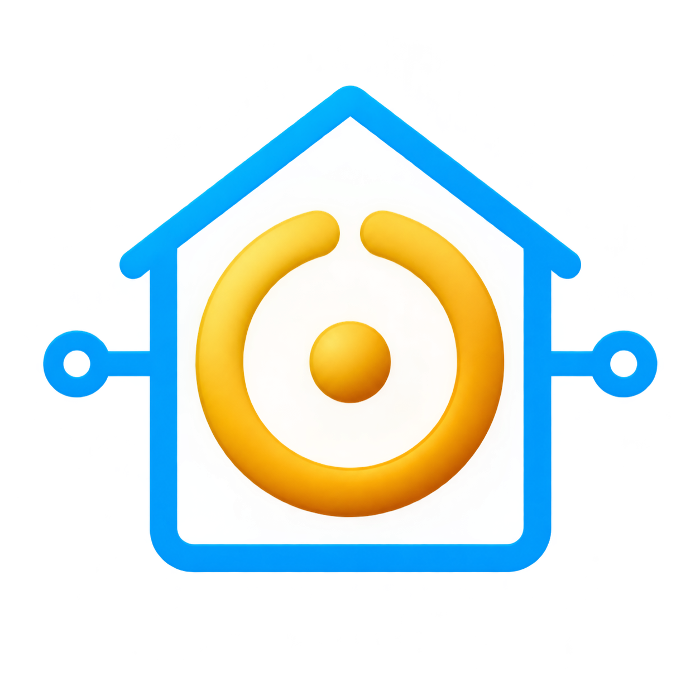

# NOOP Card



A compact, wide Home Assistant Lovelace card for displaying NOOP charge, effort, rest, battery, steps, and the time since the last sync.

The metric circles use each metric value as a percentage of a 100-point scale. For example, a charge value of `18` fills the circle to `18%`. The fill is a shaded liquid with two seamless wave crests, animated with transform only, and the motion is removed when the system requests reduced motion.

This card is designed to work with the [NOOP Push Home Assistant integration](https://github.com/MLNGE/NOOP-push), which provides the NOOP entities shown by the card.

## Installation with HACS

1. Add this repository to HACS as a custom **Dashboard** repository.
2. Install **NOOP Card** from HACS.
3. Add the card resource under **Settings > Dashboards > Resources**:

   ```yaml
   url: /hacsfiles/noop-card/noop-card.js
   type: module
   ```

4. Add the card to your dashboard.

## Manual installation

1. Copy `noop-card.js` into your Home Assistant `/config/www/noop-card/` directory.
2. Add the resource under **Settings > Dashboards > Resources**:

   ```yaml
   url: /local/noop-card/noop-card.js
   type: module
   ```

3. Add the card to a dashboard using YAML mode.

After the card is added, it can also be configured through the visual card editor. The editor provides entity selectors filtered to the `noop_push` integration for the primary NOOP entity, charge, effort, rest, battery, steps, and sync.

The visual editor is exposed through the card's `getConfigElement()` API, so Home Assistant can discover it when editing a `custom:noop-card`.

## Basic configuration

```yaml
type: custom:noop-card
entity: sensor.noop_tim_noop_charge
```

The card uses the configured entity as its anchor. The current default NOOP entities are included in `noop-card.js`.

## Explicit entity configuration

Use explicit mappings when the card is used with another NOOP device or when entity IDs differ:

```yaml
type: custom:noop-card
entity: sensor.noop_tim_noop_charge
entities:
  charge: sensor.noop_tim_noop_charge
  effort: sensor.noop_tim_daily_effort
  rest: sensor.noop_tim_noop_rest
  battery: sensor.noop_b3207b93_5202_419c_a6c0_13a6eb61cd92_noop_battery
  steps: sensor.noop_b3207b93_5202_419c_a6c0_13a6eb61cd92_noop_steps
  sync: sensor.noop_tim_noop_charge
```

The sync timestamp uses the charge entity, and reads `last_reported`, falling back to `last_updated`. The relative time refreshes every 30 seconds.
